<p align="center">
  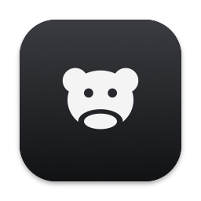
</p>

<h1 align="center">Bugbear</h1>

<p align="center">
  <b>Screenshots, recordings and a dev toolbox for people who build and test software.</b><br>
  A macOS menu bar app for QA engineers, developers, designers and support.<br>
  Catch the bug that already happened, mark it up, paste it into the ticket.<br>
  Everything runs on your Mac. Nothing is uploaded anywhere.
</p>

<p align="center">
  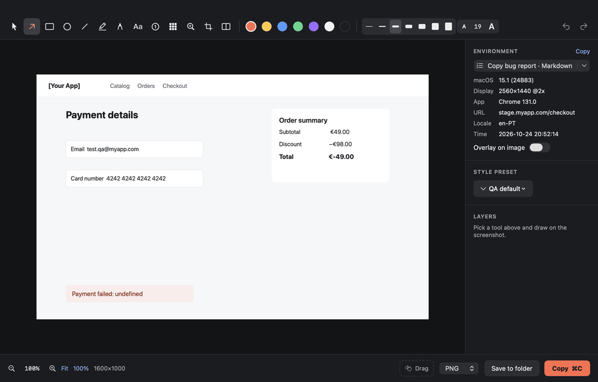
</p>

## Contents

- [Install](#install)
- [First start](#first-start)
- [Shortcuts](#shortcuts)
- [What it does](#what-it-does)
- [Updates](#updates)
- [Build from a clone](#build-from-a-clone)
- [Permissions](#permissions)
- [Uninstall](#uninstall)
- [Tests and checks](#tests-and-checks)
- [Project layout](#project-layout)

## Install

You need macOS 14 Sonoma or later (Apple silicon or Intel). Open **Terminal** and paste:

```bash
curl -fsSL https://raw.githubusercontent.com/MikeKiselyov/bugbear-app/main/scripts/install.sh | bash
```

<p align="center">
  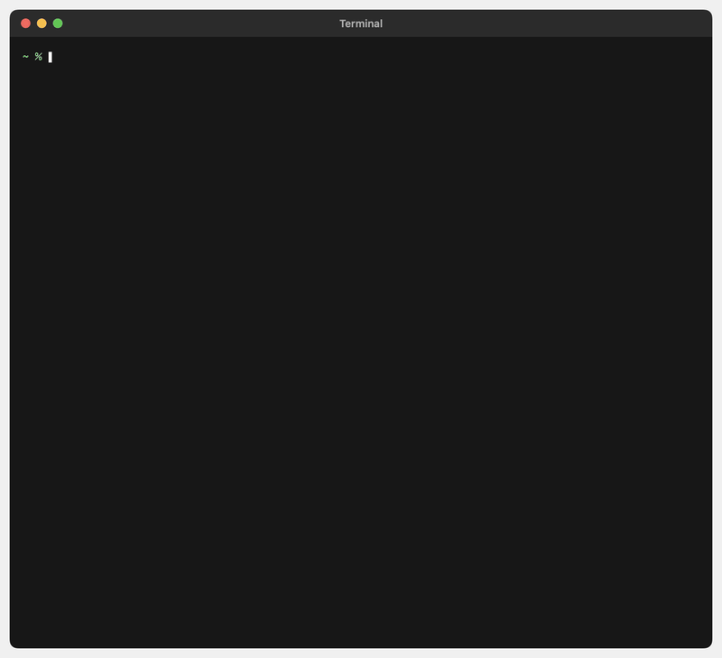
</p>

What happens:

1. The installer checks macOS and the Apple developer tools. If the tools are missing, macOS shows
   a dialog to install them (about 5 minutes); run the command again afterwards.
2. The source is downloaded to `~/.bugbear`.
3. The app is built on your Mac (the first build takes a few minutes) and copied to `/Applications`
   (or `~/Applications` without an admin account).
4. Bugbear starts. Look for the **bear icon** in the menu bar. There is no Dock icon.

Nothing is downloaded except the source code: every copy is built and signed on the Mac that runs it.
Want to read the script first? It is [`scripts/install.sh`](scripts/install.sh), about 50 lines.

## First start

A short guide opens on first launch:

1. **Screen buffer**: keep the last 1, 2, 3 or 5 minutes of the screen, or turn it off. With it off nothing
   runs in the background; screenshots, recordings and the toolbox work the same.
2. **Permissions**: the only one the app needs is **Screen & System Audio Recording**. Allow it when macOS
   asks, then press **Relaunch** in the guide. Everything else is optional (see [Permissions](#permissions)).
3. **Shortcuts** and a quick try.

Change any of it later in Settings, and reopen the guide from there.

<p align="center">
  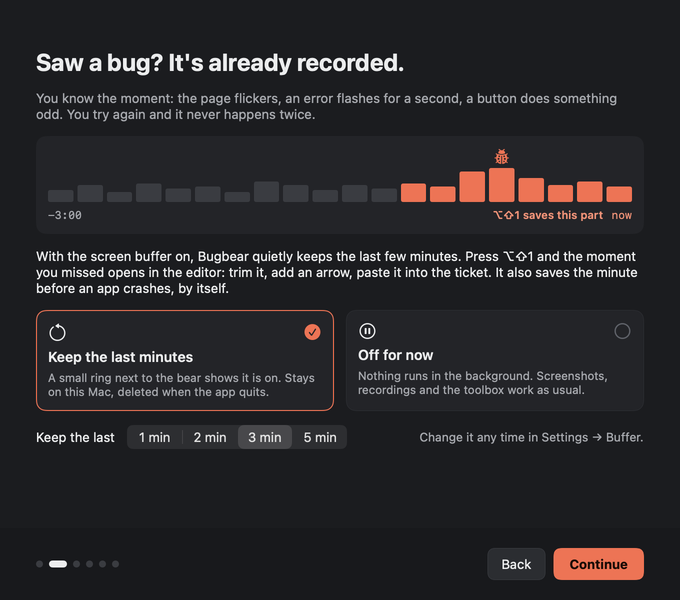
</p>

Click the bear to open the panel. It has five tabs: **Capture**, **Record**, **Tools**, **Recent** and **Space**.

<p align="center">
  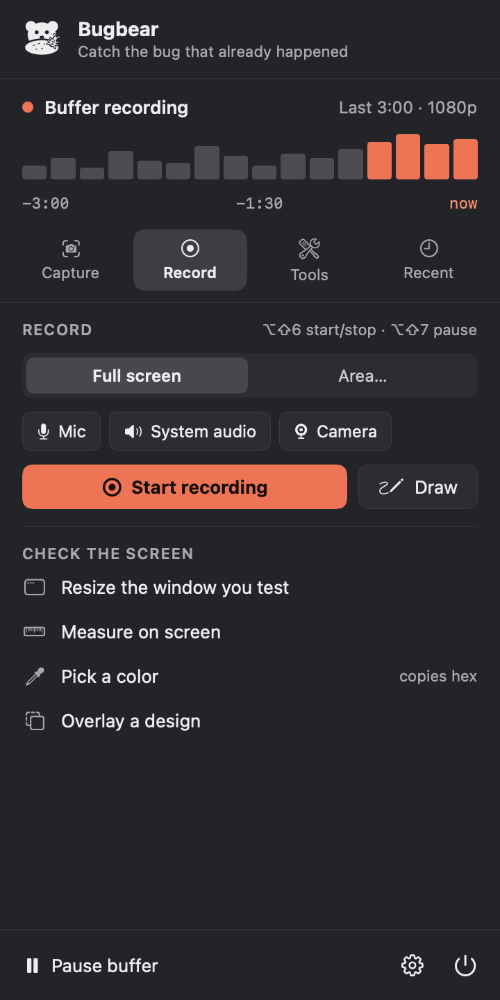
</p>

## Shortcuts

All of them work from any app. Change them, or give one to the actions that have none, in
**Settings → Shortcuts**.

| Shortcut | Action |
|---|---|
| `⌥⇧1` / `⌥⇧2` / `⌥⇧3` | Save the last 30 s / 1 min / whole buffer and open it in the video editor |
| `⌥⇧M` | Mark the moment the bug happened; the next save reaches back to include it |
| `⌥⇧4` / `⌥⇧5` | Screenshot an area / a window |
| `⌥⇧6` / `⌥⇧7` | Start or stop recording / pause or resume |
| `⌥⇧A` | Draw on the screen while recording |
| `⌥⇧C` | Webcam bubble |
| `⌥⇧O` | Copy text (or a QR code link) from a screen area |
| `⌥⇧D` | Dev toolbox with whatever is on the clipboard |
| not set | Scrolling screenshot, measure on screen, pick a color |

## What it does

### Rolling screen buffer

The app keeps the last 1-5 minutes of the screen on disk (short H.264 segments; old ones are deleted).
A bug you could not reproduce is already recorded: press `⌥⇧1` and it opens in the editor.
The buffer is optional: choose it in the first-start guide, pause it from the menu bar, or turn it off in
Settings → Buffer.

- Light on the Mac: the buffer records at 15 fps (recordings switch to 30 fps without losing what the
  buffer holds) and captures straight in the video encoder's format. With two displays the app uses
  about 70 MB of memory and a few percent of one CPU core; saving 30 seconds takes about 0.1 s.
- System audio and microphone are optional.
- Clicks and shortcut keys are recorded alongside, so the editor can show them on the video.
  Plain typing is never stored as text; it shows up as "typing…".
- When an app you used in the last 10 minutes crashes, the minute before the crash is saved to
  Recent automatically, with the macOS crash report next to it.
- Each saved clip gets the tested app's system log for the same seconds (`system.log`).

### Several displays

The buffer keeps every connected display. A saved clip holds each display on its own, so saving stays
instant, and the video editor has a switch at the top: one display, another, or all of them side by side.
It opens on the display the pointer was on. Trims, cuts, arrows and text stay when you switch; clicks are
placed for the picture you pick.

Full-screen screenshots work the same way: every display is taken at once, the editor opens on the one
under the pointer (or side by side for "All displays"), and a switch at the bottom changes it. Marks are
drawn on a picture, so each display keeps its own and they come back when you switch back. `⌥⇧4` picks an
area on any display.

| | All displays kept (default) | Main display only (Settings → Buffer) |
|---|---|---|
| Buffer, `⌥⇧1`-`⌥⇧3` | every display; switch in the editor | the main display |
| Recording, full screen | every display; switch in the editor | the display under the pointer |
| Recording an area | the display the area is on | the display the area is on |
| Screenshot, full screen | every display; opens on the one under the pointer | the same |
| Screenshot, all displays | every display; opens side by side | the same |

While recording, displays that are not in the video are dimmed and say "Not recorded". Connecting or
disconnecting a display restarts the buffer with the new set. The first-start guide asks whether to keep
all displays when more than one is connected.

### Video editor

<p align="center">
  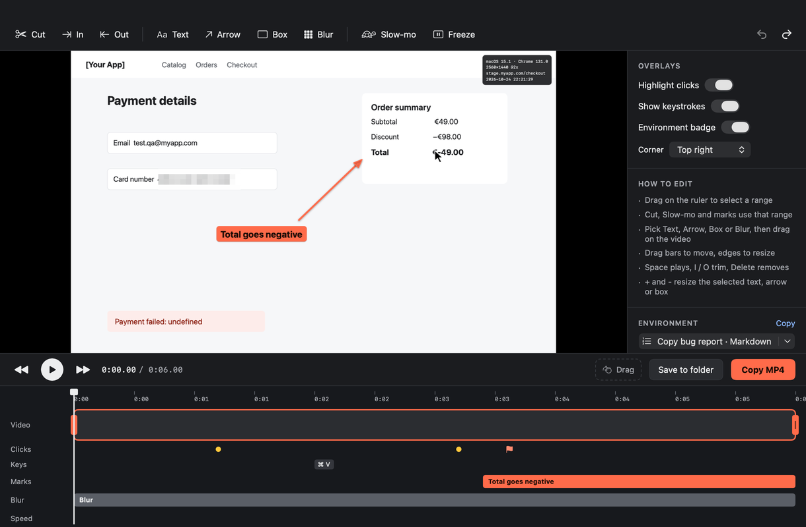
</p>

- Trim, cut out parts, slow motion, freeze frame.
- Text, arrows, boxes and blur with their own time ranges on the timeline. `+` and `-` resize them.
  Text sits on a colored label or, with Background → Transparent, is drawn as outlined letters.
- Highlight clicks, show keystrokes, environment badge.
- Export MP4 or GIF with a size limit (10-100 MB) for trackers that cap attachments.
  The preview is rendered by the same pipeline as the export.

### Recording

<p align="center">
  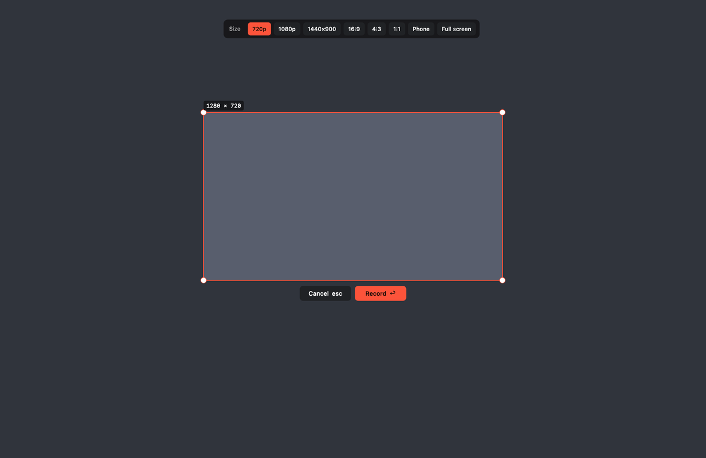
</p>

- Record full screen, all displays, or an area: ready sizes (720p, 1080p, 1440×900, 16:9, 4:3, 1:1,
  phone) or your own. The frame can be moved and resized before you start.
- While recording, a frame shows what is in the video and everything else is dimmed. The frame and
  the dimming are not in the video. Pauses are cut out of the result.
- Draw on the screen while recording (`⌥⇧A`): arrows, boxes, ellipses, pen, highlighter, numbered
  steps. The marks are part of the video and fade out after a few seconds unless pinned.
- Webcam in a round bubble (`⌥⇧C`): drag it anywhere, scroll to resize.

### Screenshots and the screenshot editor

- `⌥⇧4` area, `⌥⇧5` window, or all displays stitched into one image.
- A new screenshot is on the clipboard right away, ready for `⌘V` in a chat or a ticket, and the
  editor opens in about half a second. Settings → Screenshots turns the copying off.
- **Scrolling screenshot**: pick an area; the app scrolls it and glues one long image.
  Sticky headers and footers appear once.
- Editor: arrow, rectangle, ellipse, line, highlighter, pen, text, numbered steps, pixelate blur,
  magnifier, crop. `+` and `-` change line thickness and text size. The button next to the text size
  switches text between a colored label and outlined letters on a transparent background.
- Combine several screenshots side by side, environment badge, style presets, layers, undo and redo.
- Copy (`⌘C`), save to a folder, or drag the result straight into Jira or Slack.

### Bug reports

**Copy bug report** puts a ready report on the clipboard in Markdown or Jira wiki:

- numbered steps built from your clicks and keys (`Click "Submit" button in Safari`, `Press ⌘ Enter`);
- Expected / Actual placeholders;
- the environment: macOS, display, app and version, browser URL, locale, time;
- your own fields (stand, build, test account…) from **Settings → Bug reports**;
- the saved files.

No AI, nothing leaves the Mac. Element names need Accessibility access; password fields are never read.

### Recent captures

<p align="center">
  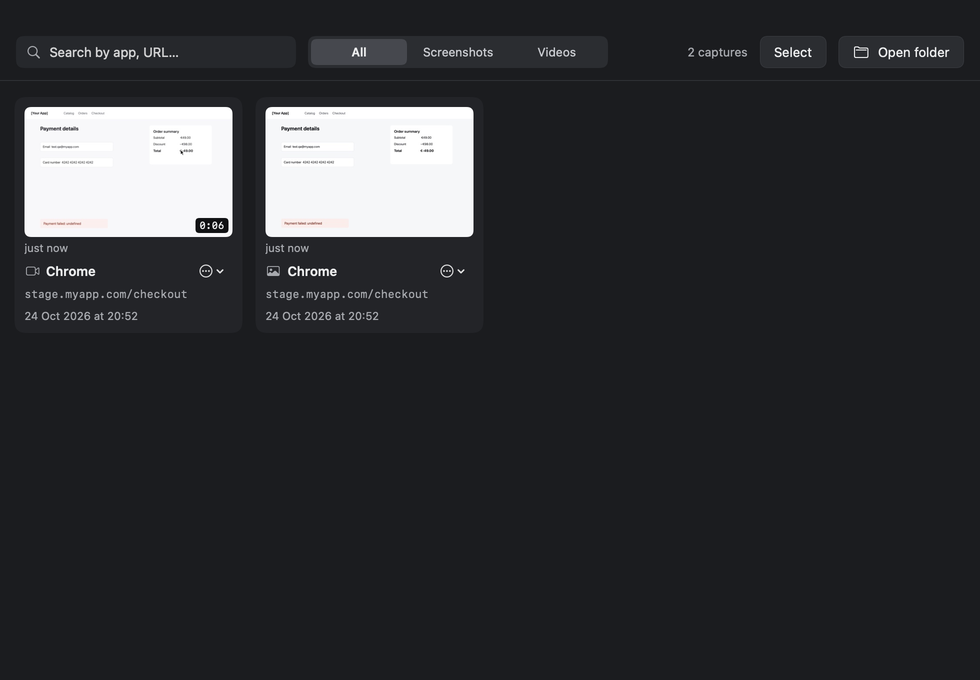
</p>

Search by app or URL, filter screenshots and videos. With **Select** you can:

- make a numbered step guide from screenshots (PNG or PDF);
- compare two screenshots (side by side, slider, changes boxed) or two clips (synced playback).

**Settings → Storage** deletes old captures automatically or keeps them under a size.

### Disk space

The **Space** tab shows how full the disk is and what can be cleaned safely; **Disk Space** opens the
full window.

- **Clean up**: app caches, Xcode DerivedData and device support, simulator caches, npm / Yarn / pnpm,
  Gradle, Homebrew, CocoaPods and pip caches, logs. Each shows its size; Clean asks once more before it
  deletes. Apps and tools make caches again when they need them. Apple's own caches are left alone.
- **Folders**: scan the home folder and walk down the biggest folders, with a bar for each.
- **Largest files**: files over 50 MB, biggest first, with Show in Finder and Move to Trash (they stay in
  the Trash until you empty it).

The scan skips what macOS guards with a permission prompt or keeps for itself: other apps' private data,
Apple's folders, the Photos and Music libraries, Contacts, Calendars, Mail, Messages and the Trash. macOS
may ask once for Desktop, Documents and Downloads.

### Check the screen

On the **Record** tab:

- resize the window you test to desktop, tablet or phone sizes;
- measure in points and pixels;
- pick a color from anywhere (hex to the clipboard);
- float a design export over the app, with opacity and click-through.

### Dev toolbox

<p align="center">
  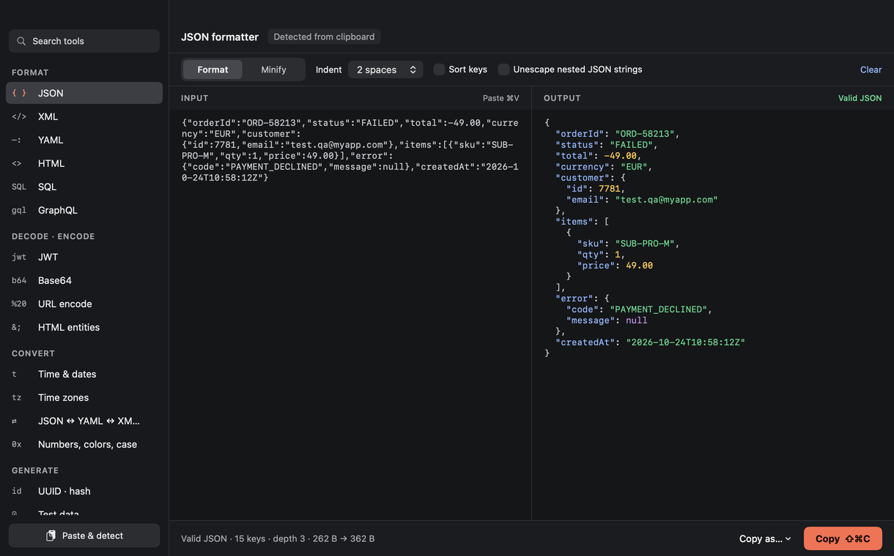
</p>

`⌥⇧D` opens it with whatever is on the clipboard and picks the right tool.

| Area | Tools |
|---|---|
| Formats | JSON (keeps key order and number text), XML, YAML, HTML, SQL, GraphQL; JSON ↔ YAML ↔ XML ↔ CSV |
| JSON | Diff (added / removed / changed paths, key order ignored), JSONPath (`$..id`, `$.items[*].price`) |
| Decode | JWT (with `exp` / `iat` as dates), Base64, URL, HTML entities, HTTP request / response parser |
| Time | Unix s / ms / µs / ns, ISO 8601, RFC 2822, ObjectId, UUID v1 / v7, `in 3 days`; cron with next runs |
| Time zones | Search by city, country, `PST` or `+5:30`, day / night strips, "compare at" slider, menu bar clock |
| Test data | People with reserved emails, phone numbers, Luhn-valid cards, IBANs, passwords, tricky inputs |
| Strings | Exact-length strings for field limits, length in characters / UTF-16 / UTF-8 bytes, regex tester |
| Other | Number bases, colors, naming case, data sizes, UUID, hashes, QR codes, WCAG contrast |

<p align="center">
  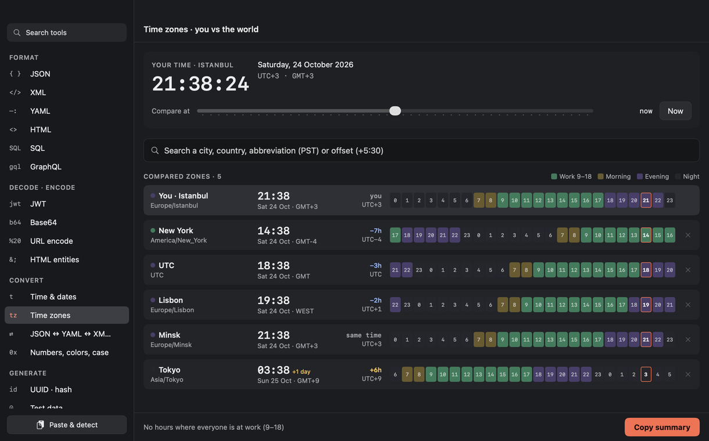
  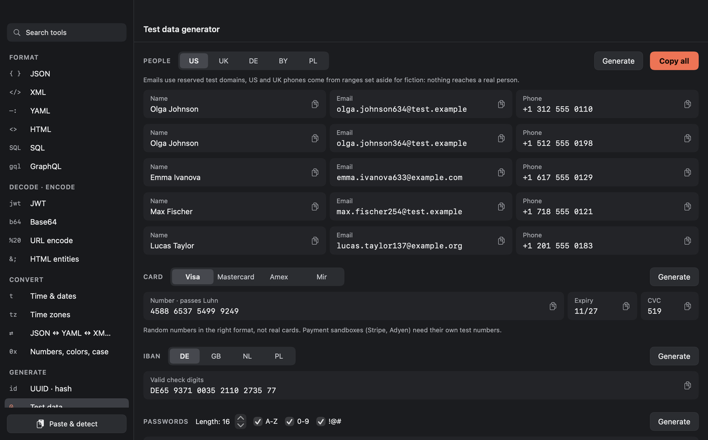
</p>

## Updates

The app checks the GitHub repository it was built from every 6 hours. When there are new commits,
an **Update** badge appears in the menu bar panel with the list of changes. **Update now** pulls the
source, rebuilds the app on your Mac (1-2 minutes) and restarts it. After an update a "What's new"
screen shows the changes.

- Check by hand or turn checks off in Settings → Updates.
- The check is one request to `api.github.com` that compares your build's commit with the branch;
  nothing about you or your captures is sent.
- If the source folder has uncommitted changes, the update stops and tells you instead of touching them.
- From a terminal: `~/.bugbear/scripts/update.sh` (or run the install command again).
- A fork updates from the fork: the repository comes from the clone's `origin`.

## Build from a clone

```bash
git clone https://github.com/MikeKiselyov/bugbear-app.git
cd bugbear-app
scripts/build-app.sh --run        # builds build/Bugbear.app and launches it
scripts/build-app.sh --install    # or: copies it to /Applications (or ~/Applications) and launches it
```

You need Apple's Command Line Tools or Xcode 16+ (Swift 6). Updates work the same way for a clone:
the app rebuilds from the folder it was built in.

### Optional: your own bundle id and signing identity

Personal settings go into `.env`, which is git-ignored and never committed:

```bash
cp .env.example .env
```

| Variable | Meaning |
|---|---|
| `BUGBEAR_BUNDLE_ID` | Bundle identifier of your build. Default `io.github.bugbear.app`. |
| `BUGBEAR_SIGN_IDENTITY` | Code signing identity. Empty: the first "Apple Development" identity in your keychain. `-`: ad-hoc. |

Why sign with a real identity: macOS ties the Screen Recording, Camera and Microphone permissions to
the app's signature. With ad-hoc signing every rebuild looks like a new app and macOS asks again.
A free Apple Development certificate (Xcode → Settings → Accounts) avoids that.
List your identities with `security find-identity -v -p codesigning`.

## Permissions

| Permission | Needed for | When it is asked |
|---|---|---|
| Screen & System Audio Recording | buffer, recordings, screenshots | first start; relaunch the app after allowing |
| Accessibility | keys in videos, element names in reports, window resize, scrolling screenshot (optional) | Settings → Recording → Grant |
| Microphone | voice in recordings (optional) | when you turn the mic on |
| Camera | webcam bubble (optional) | when you turn the camera on |
| Automation, per browser | browser URL in the environment (optional) | the first screenshot in that browser |

## Uninstall

Quit Bugbear from the panel (power button), then:

```bash
rm -rf "/Applications/Bugbear.app" "$HOME/Applications/Bugbear.app"   # the app
rm -rf ~/.bugbear                                                     # the source used for updates
rm -rf "$HOME/Library/Application Support/Bugbear"                    # captures and buffer
rm -rf "$HOME/Library/Logs/Bugbear"                                   # logs
```

Permissions can be removed in System Settings → Privacy & Security.

## Tests and checks

One command runs everything and prints a summary:

```bash
scripts/test-all.sh           # all suites, about 8 minutes
scripts/test-all.sh --quick   # unit tests and the self-test, about a minute, no permissions needed
```

| Suite | What it covers | Needs |
|---|---|---|
| `swift test` | `Sources/BugbearCore`: formatters, converters, JWT, time zones, cron, regex, JSON diff and path, HTTP, test data, the video timeline, size limits, reports, crash reports, scrolling-screenshot stitching, disk tree, updates | nothing |
| `--self-test` | a generated clip with sound through the whole editor (trim, cut, slow motion, freeze, text with and without a label, arrows, blur, clicks, keys), MP4 and GIF export, size limits, annotated and cropped screenshots, OCR, QR codes, step guides, before/after comparison, display stitching | nothing |
| `scripts/e2e.sh` | the real app: buffer, saves, recording with pause, drawing, editor export, system audio, markers, crash auto-save, update check | Screen Recording, Accessibility |
| `scripts/e2e-features.sh` | a Chrome page: scrolling screenshot, window resize, ruler, color picker, design overlay, area recording, shortcuts, Jira and Markdown reports, step guide, comparison, editor sizes, switching between displays, the menu panel, What's New, disk space scan and clean-up | Screen Recording, Accessibility, Chrome |
| `scripts/perf.sh` | CPU and memory idle and while recording, save time | Screen Recording |

The scripts drive the real app through a local automation hook (off by default, switched on only for
the run). They move the mouse and open a Chrome window; don't touch the Mac while they run. Logs of
the last run are in `build/test-logs/`.

The pictures in this README are rendered off screen from a made-up page, so they can be regenerated
on any Mac without permissions: `scripts/readme-media.sh` (needs `ffmpeg`).

Logs: `~/Library/Logs/Bugbear/bugbear.log` (attach it to bug reports about the app).

## Project layout

```
Sources/BugbearCore/     pure logic, no UI: toolbox, time, timeline math, reports, stitching
Sources/Bugbear/
  App/                    entry point, app state, windows
  Capture/                screen buffer, exporter, screenshots, environment, input events
  Recording/              recording session, HUD, draw-on-screen, camera bubble, area picker, ruler
  Annotations/            annotation model and renderer (shared by editor, export, live overlay)
  Editors/                screenshot and video editors
  Toolbox/                dev toolbox screens
  MenuBar/, History/, Settings/, Onboarding/
scripts/                  install, update, build, e2e and perf checks, README pictures
docs/images/              the pictures in this README
```

The logo (a bear eating a bun) is one flat shape drawn in code in `Support/Logo.swift`: the menu bar
glyph, the in-app logo and the app icon are the same picture. The build script renders the `.icns` from it.

Storage: captures in `~/Library/Application Support/Bugbear/Captures/`, buffer segments in
`…/Bugbear/Buffer/` (cleared on launch and quit), exports in the folder chosen in Settings
(Desktop by default).
