# Everything Bugbear does

A full list in plain words, for testers, developers, designers and support. The short version is in
the [README](../README.md). Everything here runs on your Mac; nothing is uploaded anywhere.

- [The menu](#the-menu)
- [Catch a bug that already happened](#catch-a-bug-that-already-happened)
- [Screenshots](#screenshots)
- [Recording the screen](#recording-the-screen)
- [Drawing on the screen](#drawing-on-the-screen)
- [The video editor](#the-video-editor)
- [Bug reports](#bug-reports)
- [Recent captures](#recent-captures)
- [Checking a layout](#checking-a-layout)
- [Dev toolbox](#dev-toolbox)
- [Disk space](#disk-space)
- [Settings](#settings)
- [Permissions](#permissions)
- [Updates and feedback](#updates-and-feedback)

## The menu

<p align="center">
  
</p>

Bugbear lives in the menu bar as a bear with a magnifying glass. Click it, or press `⌥⇧B` from any
app, to open the menu. Its tabs:

- **Capture**: save the last 30 seconds, 1 minute or 3 minutes of the screen, and every kind of
  screenshot.
- **Record**: start a recording, draw on the screen, show the camera, and the tools for checking a
  layout.
- **Tools**: the dev toolbox.
- **Recent**: the latest captures.
- **Space**: what fills the disk and what can be cleaned.

At the bottom of the Capture tab, **Environment** shows what goes into every report: macOS, the Mac,
the display, the app in front, its page, language, light or dark, time. **Edit** next to it opens the
report fields in Settings. If every field is turned off, it says so and offers to choose fields.

The bear stays visible on a Mac with a notch: if macOS hides it behind the notch, Bugbear moves it
next to the system icons.

## Catch a bug that already happened

Bugbear keeps the last 1 to 5 minutes of the screen on disk, all the time, and deletes older parts as
it goes. The bug you could not reproduce is already recorded:

<p align="center">
  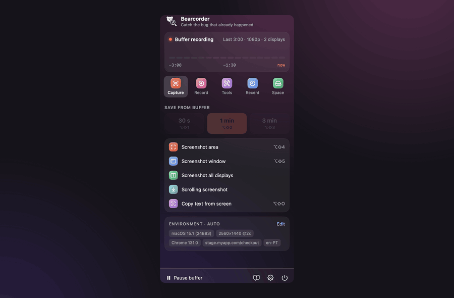
</p>

| Keys | What it saves |
|---|---|
| `⌥⇧1` | the last 30 seconds |
| `⌥⇧2` | the last minute |
| `⌥⇧3` | everything in the buffer |
| `⌥⇧M` | marks the moment: the next save reaches back to it and opens there |

- The clip opens in the video editor right away. Saving is instant: nothing is re-encoded.
- Every display is kept. The editor has a switch at the top: one display, another, or all side by
  side. It opens on the display the pointer was on.
- When the displays go away (the lid closes, a monitor is unplugged, the Mac sleeps), the buffer
  starts again by itself as soon as a display is back.
- Clicks and shortcut keys are recorded with the clip and can be shown on the video and turned into
  steps.
- When an app you used in the last 10 minutes crashes, the minute before the crash is saved for you,
  with the macOS crash report next to it.
- Each clip gets the app's system log for the same seconds.
- The buffer is light: a few percent of one CPU core. You can pause it from the menu or turn it off
  in Settings.

## Screenshots

<p align="center">
  
</p>

| Keys | Screenshot |
|---|---|
| `⌥⇧4` | an area you pick |
| `⌥⇧5` | a window |
| menu | the full screen, or all displays in one picture |
| menu | a **scrolling screenshot**: Bugbear scrolls the area and glues one long picture |
| `⌥⇧O` | copies the text in an area you pick |

A new screenshot is on the clipboard at once, ready for `⌘V` in a chat or ticket, and the editor
opens in about half a second.

**The screenshot editor:**

- Arrow, **arrow with text** (drag to the problem, type the note at the tail), rectangle, ellipse,
  line, highlighter, pen, text, numbered steps, blur, magnifier, crop.
- `+` and `-` change the line or text size. Text can sit on a colored label or be outlined letters on
  a transparent background.
- Five recent colors and any color from the color picker. The editor remembers the last tool, color
  and size.
- Paste a picture with `⌘V` or drop one in; combine several screenshots side by side.
- Layers list, undo and redo, Delete removes the selected mark.
- An environment badge on the picture, in the corner you choose, with every field that is on.
- Copy with `⌘C`, save to a folder, or drag the result straight into Jira or Slack.

## Recording the screen

<p align="center">
  
</p>

- Record the full screen, all displays, or an area: ready sizes (720p, 1080p, 1440×900, 16:9, 4:3,
  1:1, phone) or your own. Before you start, drag the grip above the frame (or anywhere inside it) to
  move it and drag a corner or an edge to resize it; the pointer shows which one a drag does.
- With more than one display the picker covers all of them: the area can go onto any display or
  across two, before and while recording. The video shows both parts in their places, at the
  sharper display's density; where the area covers no display (beside a smaller one) it is black.
- While recording, a frame shows what is in the video and the rest is dimmed; neither is in the
  video. Displays that are not recorded say so.
- The frame of an area keeps its handles while recording: drag a corner or an edge to make the
  area bigger or smaller, or the grip above the frame to move the whole area, to another display
  too. Clicks inside the
  area still go to the app under it. The video gets the area as it is when you stop. After you pick
  the area, the app you were in is in front again.

<p align="center">
  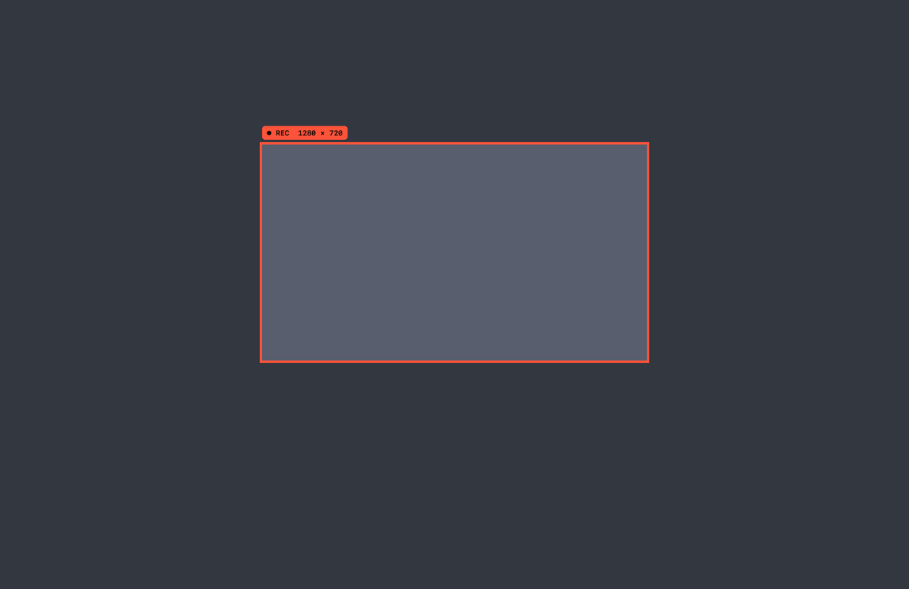
</p>

- `⌥⇧6` starts and stops a recording, `⌥⇧7` pauses and resumes; the pause is cut out of the result.
- System audio and your microphone are optional. A round camera bubble (`⌥⇧C`) can be dragged
  anywhere and resized by scrolling.

## Drawing on the screen

<p align="center">
  
</p>

Press `⌥⇧A` or Draw in the menu and draw right on the screen, while recording or not: arrows, text,
boxes, ellipses, pen, highlighter, numbered steps. With Text, click where the note goes and type;
Return keeps it, `Esc` drops it. Drawing goes on the display the pointer is on. Marks fade after a few
seconds unless you pin them, and they are part of the recording. `Esc` ends drawing, `⌘Z` undoes,
Delete clears.

## The video editor

<p align="center">
  
</p>

- **Trim** with In and Out (`I`, `O`), **cut** a range out, **slow motion**, **freeze frame**.
- **Marks**: text, arrows, boxes and blur. Click with Text and type right on the video; double
  click picked text to change it. Drag with Arrow, Box or Blur; you see the shape while dragging.
  A new mark lasts 3 seconds from the playhead.
- Every mark has a bar on the timeline: drag its middle to move it in time, its edges to make it
  shorter or longer. On the video, drag a mark to move it; it stays inside the frame.
- The size in the toolbar (or `+` and `-`) resizes the selected mark, and with nothing selected sets
  the size of the next text, arrow or box; the editor remembers it. Text can be a label or outlined
  letters.
- **Crop** keeps only part of the screen: the whole frame shows, drag the edges or draw the part to
  keep, then Done. Marks, clicks and blur stay on the picture; keystrokes, steps and the badge stay
  in the corners of the cropped video. Reset brings the whole screen back.

<p align="center">
  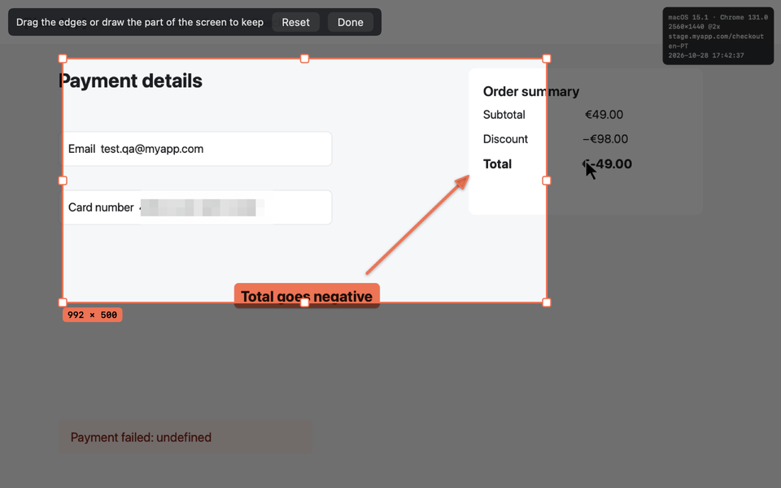
</p>

- Show clicks, keystrokes and the steps as captions, and the environment badge.
- Export MP4 or GIF, pick the quality, and set a size limit (10 to 100 MB) for trackers that cap
  attachments. Copy the file, save it, or drag it out.
- Undo and redo for everything; the editor remembers your last choices for the next clip.

## Bug reports

<p align="center">
  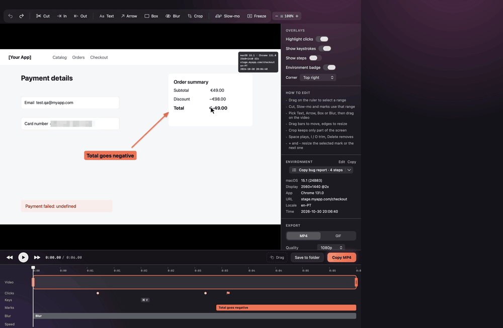
</p>

**Copy bug report** puts a ready report on the clipboard, in Markdown or Jira wiki. The button says
how many steps the report has. A report looks like this:

```
## Steps to reproduce
1. Open shop.test/login
2. Type "john@test.com" in "Email" text field
3. Click "Sign in" button in Google Chrome
4. ⚑ Bug moment

## Expected result

## Actual result

## Environment
- macOS: 26.6.2 (25G83)
- App: Google Chrome 156.0
- URL: https://shop.test/login
- Time: 2026-10-27 15:28:28
```

- Steps come from your clicks and keys, with the names of the buttons and fields. Typing in one
  field is one step, Space and Delete included. A step is added for every page you open.
- What you typed is shown only if you turn on **Show what I type in steps**. Password fields are
  never read.
- The environment is the fields that are on, under the names you gave them, plus your own fields.
- No times, no file paths: just what someone needs to repeat the bug.

## Recent captures

<p align="center">
  
</p>

Captures sorted by day, with a sidebar to show only screenshots, only videos, or one app. Search by app
or address. With **Select**:

- make a numbered **step guide** from screenshots (PNG or PDF);
- **compare** two screenshots (side by side, slider, changes boxed) or two clips played in sync.

<p align="center">
  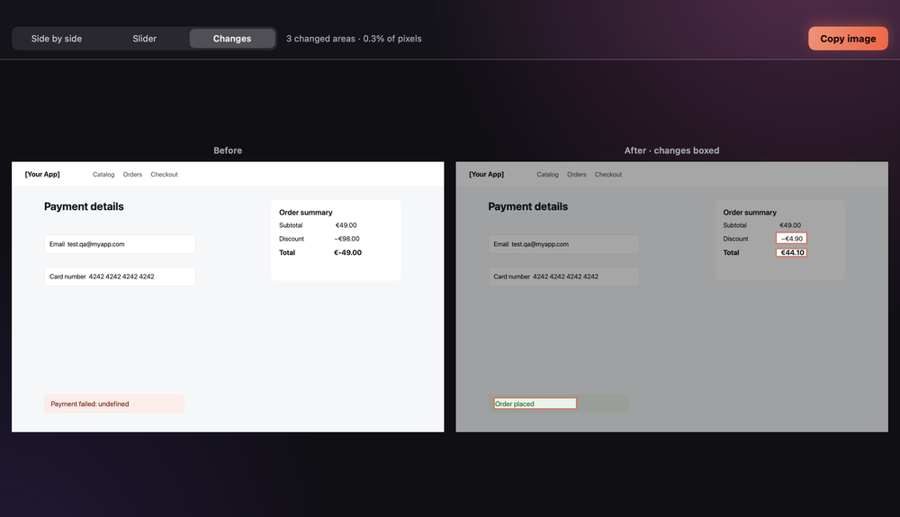
</p>

A step guide is one tall picture, or one page per step in a PDF: a title, then each screenshot
with its number and a line of text you write.

<p align="center">
  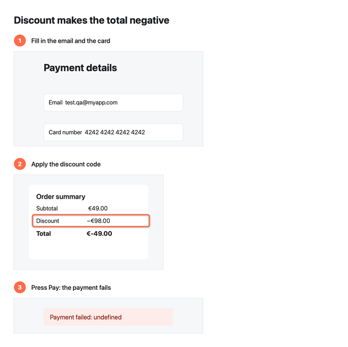
</p>

Old captures can be deleted automatically, or kept under a size (Settings → Storage).

## Checking a layout

On the Record tab:

- resize the window you test to desktop, tablet or phone sizes;
- measure on the screen in points and pixels;
- pick a color anywhere (the hex goes to the clipboard) and check contrast;
- float a design export over the app, with opacity and click-through.

<p align="center">
  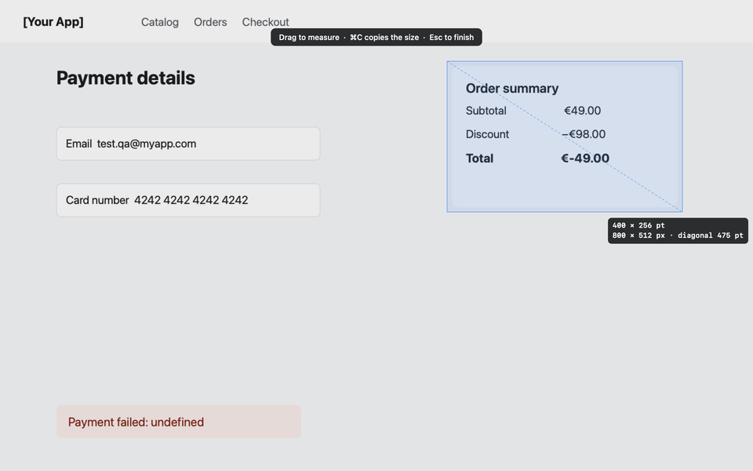
</p>

<p align="center">
  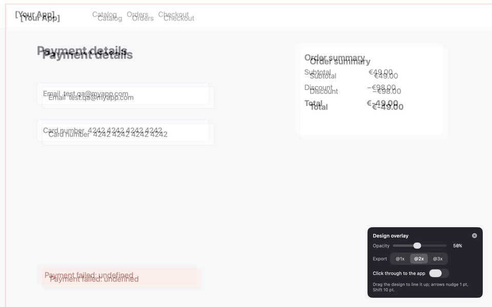
</p>

<p align="center">
  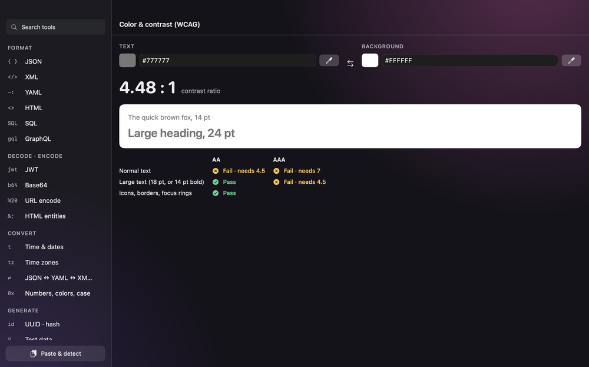
</p>

## Dev toolbox

<p align="center">
  
</p>

`⌥⇧D` opens it with what is on the clipboard and picks the right tool.

| Area | Tools |
|---|---|
| Formats | JSON, XML, YAML, HTML, SQL, GraphQL; JSON ↔ YAML ↔ XML ↔ CSV |
| JSON | diff of two documents, JSONPath |
| Decode | JWT, Base64, URL, HTML entities, HTTP requests and responses |
| Time | Unix times, ISO 8601, RFC 2822, `in 3 days`, cron with the next runs |
| Time zones | search by city, country or offset, compare at a time, a clock in the menu bar |
| Test data | people, phone numbers, valid cards and IBANs, passwords, tricky inputs |
| Strings | strings of an exact length, lengths in characters and bytes, regex tester |
| Other | number bases, colors, naming case, data sizes, UUID, hashes, QR codes, contrast |

<p align="center">
  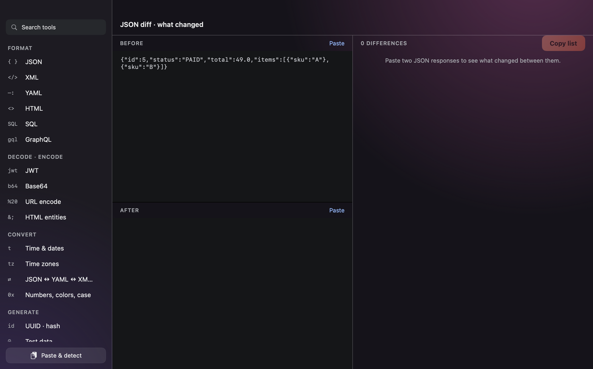
</p>

## Disk space

<p align="center">
  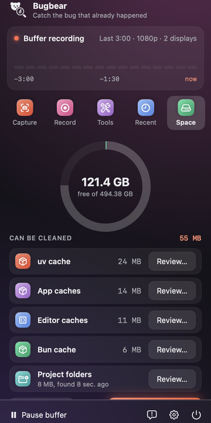
</p>

The Space tab shows how full the disk is and what can be cleaned safely: app caches, Xcode build data
and simulators, npm, Yarn, Gradle, Homebrew, CocoaPods, pip, uv, Bun, Go modules, Maven, Hugging Face,
pre-commit, Cursor and VS Code and Playwright caches, logs. Caches that need a program to clean them
(like Go modules) are cleaned with that program.

**Review…** next to a category opens a list of what is inside, with a size and a checkbox each. Tick
what goes and press the button at the bottom, for example "Move 2 folders, 1.2 GB to the Trash".
Caches are deleted for good, since the tools download or build them again; project folders go to the
Trash. It asks once more, and every item is checked again right before it is removed. Something that
changed since the scan or a link is not removed, and the list says why. Folders tracked by git are
left out of the list. Maven rows start unticked: libraries you installed with mvn install may not
come back.

<p align="center">
  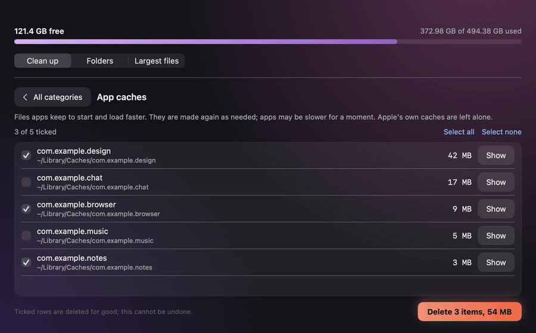
</p>

**Find projects** in the Disk Space window searches your project folders for node_modules, Python
environments, Pods, Rust and Swift build folders and Gradle folders. Projects not touched for 30 days are
ticked, the others are not. Ticked folders go to the Trash, so you can put them back. **Delete … for
good** after a removal asks once more, then deletes only what Bugbear moved to the Trash, not the
rest of it.

<p align="center">
  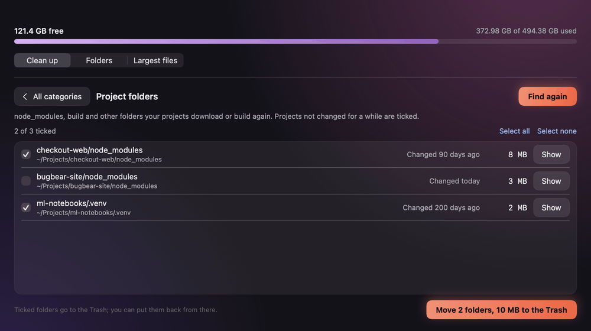
</p>

The Disk Space window also walks down the biggest folders and lists files over 50 MB, with Show in
Finder and Move to Trash.

The **Project clean-up** group in Settings → Storage sets the folders to search (inside your home
folder, not in Library), after how many days a project counts as old, whether folders go to the Trash or are deleted
at once, which kinds of folders to look for, and which extra caches to show.

## Settings

<p align="center">
  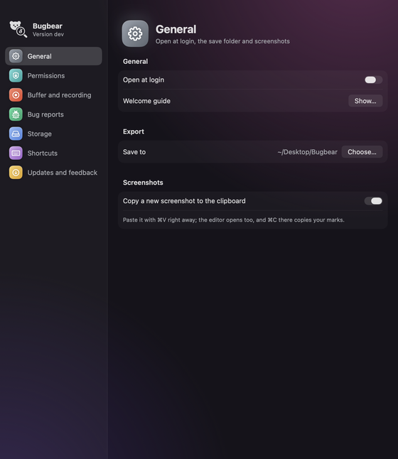
  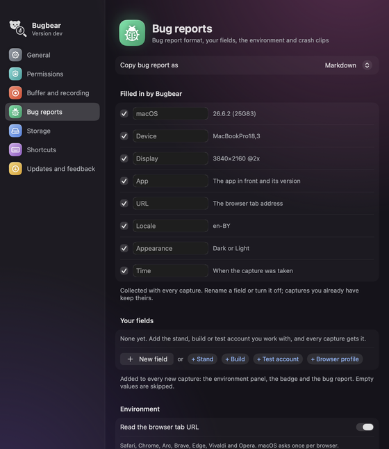
</p>

Settings has pages in a sidebar:

- **General**: open at login, the welcome guide, where files are saved, copying new screenshots.
- **Permissions**: see below.
- **Buffer and recording**: how long the buffer is, frame rates, displays, sound, clicks and keys,
  showing what you type.
- **Bug reports**: Markdown or Jira; every field Bugbear fills in, with a switch and your own name
  for it; your own fields like stand, build or test account; crash clips and system logs. Open
  captures follow a change at once.
- **Storage**: space used, automatic clean-up and project clean-up.
- **Shortcuts**: change any shortcut; a taken one is refused.
- **Updates and feedback**: updates, What's new, and reporting a problem.

## Permissions

<p align="center">
  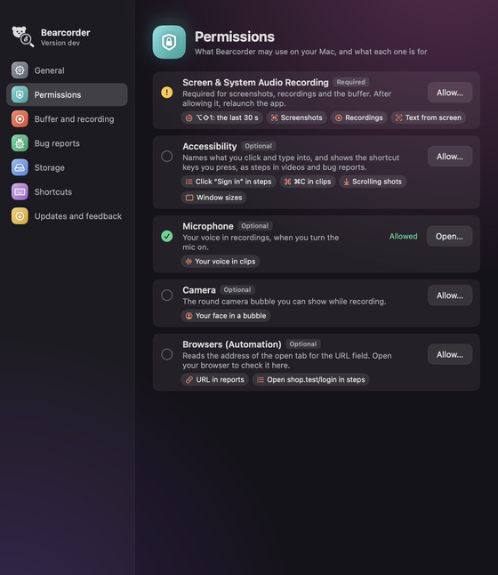
</p>

The Permissions page lists what Bugbear may use, whether it is allowed, and what it is for. **Allow…**
asks macOS for a missing one; for Screen Recording and Accessibility macOS shows its window only the
first time, so pressing Allow… again opens System Settings instead. **Open…** shows an allowed one in
System Settings.

| Permission | What for |
|---|---|
| Screen & System Audio Recording (required) | the buffer, screenshots, recordings |
| Accessibility | names of what you click in steps, keys in videos, scrolling screenshots, window sizes |
| Microphone | your voice in recordings |
| Camera | the camera bubble |
| Browsers (Automation) | the page address in reports |

After allowing Screen Recording, Quit & Reopen in System Settings opens Bugbear again by itself.

## Updates and feedback

<p align="center">
  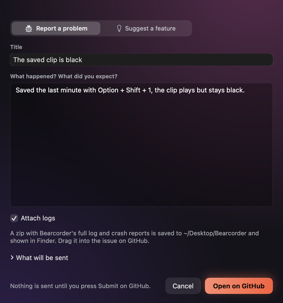
</p>

- Bugbear checks for a new version every 6 hours and shows a badge in the menu. Update now rebuilds
  it on your Mac and restarts it; What's new shows what changed, with pictures.
- **Report a problem** or **suggest a feature** from the menu: it opens a filled-in GitHub issue,
  and can attach a zip of the logs.
- Uninstall everything with one command: see [uninstall](uninstall.md). At the end it asks, if you
  can, to say in a short form what you did not like.
